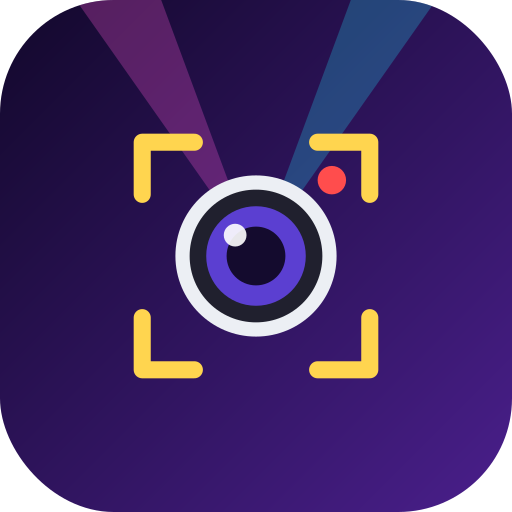

# ConcertCam

**專為演唱會手持拍攝設計的 Android 相機 App**（單手舉高手機、直立拍攝為主；在 Motorola Edge 60 Pro 上開發測試）。

*A concert-focused Android camera: lens lock, auto focus-lock, tap-to-focus/meter, stage-light exposure protection, front+back dual recording.*

## 它解決什麼問題
- 變焦時系統自動切換鏡頭，畫面角度突然跳一下
- 手一抖，對焦就「拉風箱」，歌手忽然變糊
- 舞台很亮、四周很黑，自動曝光亂跳、人臉過曝

## 主要功能
- **鎖定鏡頭**：右邊緣變焦條，滑到刻度（0.6x / 1x / 2x / 3x / 5x…）才切換並鎖住該鏡頭，不會亂切；螢幕頂部大字顯示「目前實際使用的鏡頭」
- **穩定後自動鎖焦**：手機穩定約 5 秒就鎖定對焦與白平衡，手抖、掃過去都不再重新對焦；真的轉向新目標並穩定後才重新對焦
- **點擊對焦 + 點測光**：點螢幕＝解除鎖定，並對焦、測光到你點的位置
- **舞台曝光**：測光只看被點的位置，高光過曝時自動壓低曝光；可直接拖 EV、快門、ISO（拖快門＝快門固定、ISO 自動；拖 ISO＝全手動）
- **防抖**：光學 / 光學+電子 / 增強（視手機支援）
- **前後鏡頭同時錄影**（需手機系統支援）、4K / 1080p
- **單手操作**：按鈕集中在右側拇指區；長按畫面或「⚙」彈出扇形選單，按住滑到圖示放手即設定，停留可展開下一層

## 和一般相機 App 有什麼不同
| | 一般相機 App | ConcertCam |
|---|---|---|
| 變焦時的鏡頭 | 系統自動切換，容易角度突跳 | 可鎖定單一鏡頭，只在你滑到刻度時才切 |
| 手抖時的對焦 | 重新搜索（拉風箱） | 穩定後鎖定，手抖不影響 |
| 點擊螢幕 | 只對焦 | 對焦 ＋ 測光到該點 ＋ 解除鎖定 |
| 強光舞台 | 整體測光，容易過曝 | 點測光 ＋ 高光保護 ＋ 可調 EV / 快門 / ISO |
| 前後鏡頭 | 多半只能二選一 | 可同時錄影 |
| 操作位置 | 按鈕分散在畫面上下 | 集中右側拇指區 ＋ 扇形選單 |

## 下載安裝
直接下載最新版 APK（每次更新後自動編譯，可直接覆蓋安裝）：

**[ConcertCam.apk](https://github.com/mrjackychung/ConcertCamera/releases/latest/download/ConcertCam.apk)**

## 操作速覽
- 點畫面：對焦 + 測光　｜　雙指或右側變焦條：變焦
- 長按畫面 / 長按「⚙」：扇形選單（滑到圖示放手即設定）
- 點左上角的曝光讀數：展開 EV / 快門 / ISO 滑杆
- 左上角提示條與黃色方框會顯示對焦是否已鎖定

## 注意
部分功能取決於手機是否向第三方 App 開放：長焦鏡頭、手動 ISO / 快門、前後同時錄影。不支援時 App 會自動改用替代方案或給出提示。
